<h1 align="center">QMusic-CircleWatch</h1>
<p align="center">把音乐、歌词和播放控制，放进适合圆形手表的界面。</p>
<p align="center"><b>OPPO 圆表适配 · 胶囊列表 · 真实逐字歌词 · 表冠与短震反馈</b></p>
<p align="center">
  <a href="https://github.com/SIAKNG/QMusic-CircleWatch/releases/tag/v1.0">下载 1.0</a> ·
  <a href="#界面预览">界面预览</a> · <a href="#二创主要更新">二创更新</a> ·
  <a href="#第一次使用">使用方法</a> · <a href="#工程组成与实现">工程组成</a> ·
  <a href="CHANGELOG.md">版本记录</a>
</p>

QMusic-CircleWatch 是基于 [huanghao897/QMusicWatch](https://github.com/huanghao897/QMusicWatch) **0.9.14** 二次开发的 Android 手表音乐客户端，由 **SIAKNG** 维护本次圆表适配。
保留搜索、音乐库、播放、歌词、缓存与账号权益判断，并结合 OPPO 圆表资料完善布局、实体表冠、原生短震和滚动动画。

当前版本 **1.0**，安装包 **QMusic-CircleWatch-1.0.apk**，独立包名 `com.qmusicwatch.round`。最低 Android 7.0；主要实机验证设备为 **OPPO OWW251，Android 11，466 × 466**。方屏保留既有布局分支，其他设备尚未逐台实测。

本仓库与 Release **已公开，源码、界面展示与 1.0 安装包均可直接查看和下载**。本项目不隶属于腾讯、QQ 音乐或 OPPO；音乐与授权沿用原工程服务，不内置曲库或会员授权。

> 图片为本工程原生页面在 OWW251 手表上的实际渲染，使用独立离线展示包和演示数据。歌名、歌单、账号、歌词与二维码均为示例，二维码不能登录。来源见 [截图说明](docs/SCREENSHOTS.md)。

## 版本更新

### 1.0 · 2026-11-01（当前版本）

- 统一 OPPO 圆表布局与胶囊形选项，收紧列表间距，改善圆屏边缘显示和触控。
- 滚动时将底部迷你播放器收起为专辑圆标，用描边显示实际播放进度，点击展开。
- 顶部时间使用薄型全宽半透明渐变，软化进入时间区的滚动内容。
- 支持逐字歌词与双语翻译；依据有效逐字时序推进，无时序则整行高亮；统一未播放行灰度并柔化进度边界。
- 适配 OWW251 表冠输入与 OPPO 原生短震，减少快速或反向滚动时的抖动。
- 改善列表与歌词绘制；采用独立名称与签名，隔离原版 APK 更新入口。

[下载 QMusic-CircleWatch 1.0](https://github.com/SIAKNG/QMusic-CircleWatch/releases/download/v1.0/QMusic-CircleWatch-1.0.apk) · [发布说明](https://github.com/SIAKNG/QMusic-CircleWatch/releases/tag/v1.0) · [完整更新记录](CHANGELOG.md)

## 功能一览

| 功能 | 可以做什么 |
| --- | --- |
| 发现与推荐 | 查看每日推荐，进入曲目与搜索；搜索歌单后可查看详情 |
| 搜索 | 输入关键词，查看历史和结果列表，选择歌曲播放 |
| 音乐库 | 查看喜欢、自建及收藏歌单、最近播放，保留原有账号操作 |
| 扫码登录 | 显示授权二维码与有效期，根据页面提示在手机端授权 |
| 播放控制 | 播放/暂停、上一首/下一首、进度、喜欢、模式与队列 |
| 迷你播放器 | 滚动收起为专辑圆标与真实进度环，点击展开 |
| 歌词与翻译 | 逐字歌词、双语翻译与当前行强调，无逐字时序时整行高亮 |
| 队列与模式 | 查看并管理播放队列；顺序、循环和随机播放 |
| 音质 | 按曲目和账号权益显示标准、HQ、SQ 的可用性 |
| 缓存管理 | 显示任务与本地曲目，保留仅 Wi-Fi 缓存等设置 |
| 表冠与触觉 | 列表滚动、可选音量控制、OPPO 短震与系统回退 |
| 个性设置 | 界面字号、主题、歌词、睡眠定时、耳机提醒与播放行为 |

详细操作见 [功能说明](docs/FEATURES.md)。Hi-Res 未宣称可播放；版权、会员权益、网络和上游接口仍决定实际可用范围。

## 二创主要更新

原版 **已有部分圆屏布局、表冠和逐字歌词**。本版在其基础上完善 OPPO 圆表体验，不将原有音乐业务列作二创新增。

| 重点 | 本版最终效果 |
| --- | --- |
| 圆表布局 | 比例留边、稳定的边缘缩放、胶囊选项、圆形确认按钮与统一触控区 |
| 播放入口 | 胶囊与专辑圆标切换，实际进度环与点击展开 |
| 歌词 | 逐字歌词与双语翻译、稳定强调、跨行顺序上色、柔和进度前沿、同灰度非当前行 |
| 时间区 | 轻薄全宽透明渐变与阴影，软化重叠；不依赖实时背景模糊 |
| 表冠 | 识别 OWW251 鼠标式滚轮，合并限速并过滤反向噪声 |
| 原生短震 | OPPO 线性马达效果 302，按距离和时间节流并遵守系统开关 |
| 流畅度 | 稳定列表测量、歌词绘制阶段推进、按实际窗口帧采样 |
| 独立维护 | 独立包名及签名，改名保留本项目数据，隔离原版更新包 |

逐项对照见 [与原版相比改了什么](docs/UPSTREAM_DIFF.md)。

## 界面预览

点击图片可查看原始 PNG。长页面展示首屏，完整选项仍可在应用内滚动查看。截图是原生实机渲染，不是重新绘制的概念图。

### 首页与播放入口

| 发现首页 | 收起的专辑圆标与进度环 | 我的音乐 |
| :---: | :---: | :---: |
| 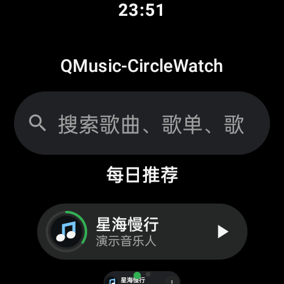 | 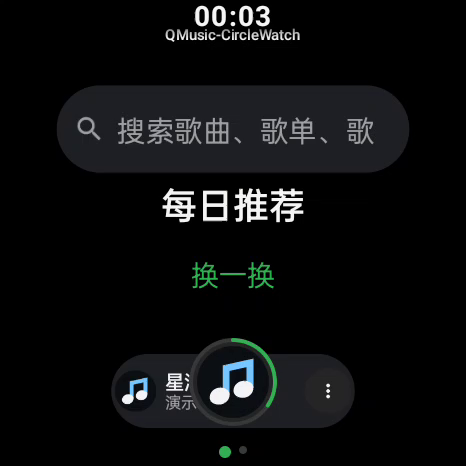 | 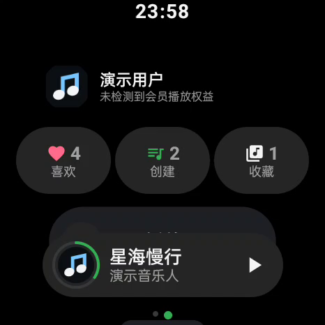 |

### 搜索与登录

| 搜索与历史 | 搜索结果 | 扫码登录布局 |
| :---: | :---: | :---: |
| 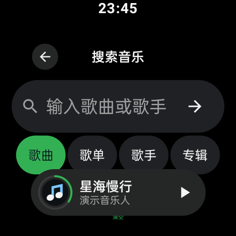 | 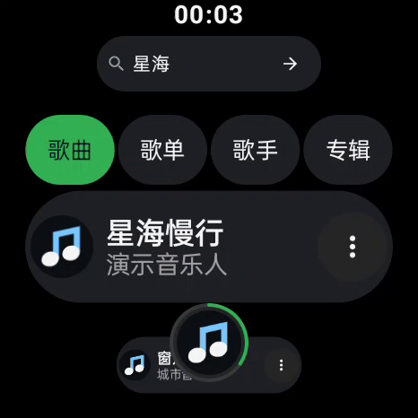 |  |

### 音乐库与歌单

| 喜欢的歌曲 | 自建歌单 | 收藏歌单 |
| :---: | :---: | :---: |
| 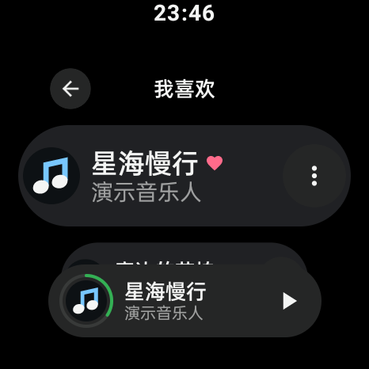 | 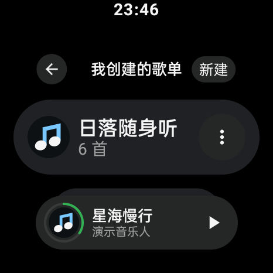 | 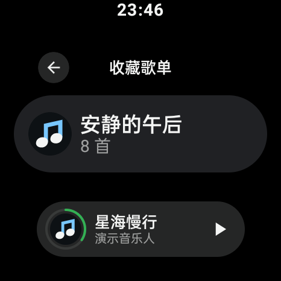 |

### 最近、详情与缓存

| 最近播放 | 歌单详情 | 缓存与任务 |
| :---: | :---: | :---: |
| 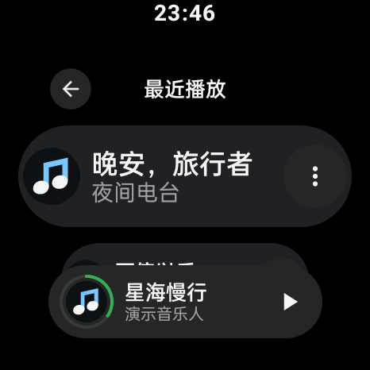 | 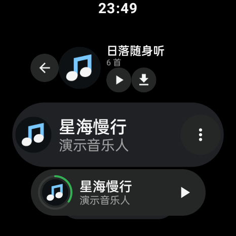 | 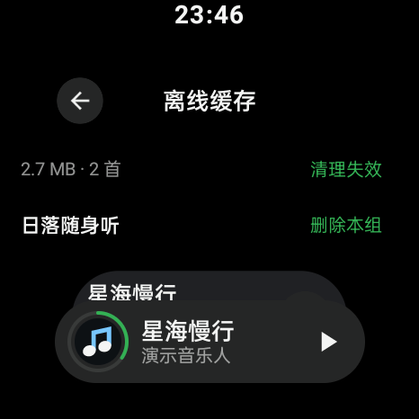 |

### 播放器与歌词

| 播放控制 | 逐字歌词与双语翻译 | 播放队列 |
| :---: | :---: | :---: |
| 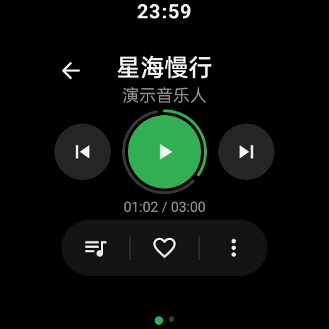 | 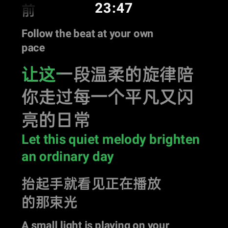 | 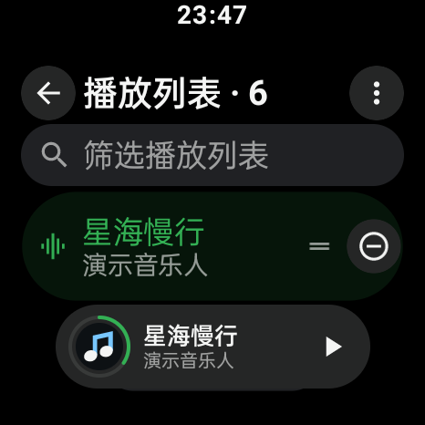 |

### 设置与显示

| 设置中心 | 显示与歌词设置 | 播放设置 |
| :---: | :---: | :---: |
| 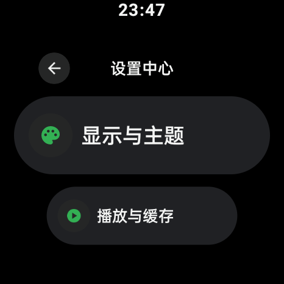 | 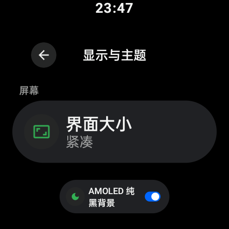 | 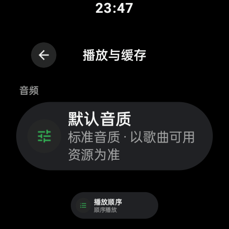 |

### 网络、关于与选择

| 网络与缓存设置 | 关于与版本 | 选择弹层 |
| :---: | :---: | :---: |
| 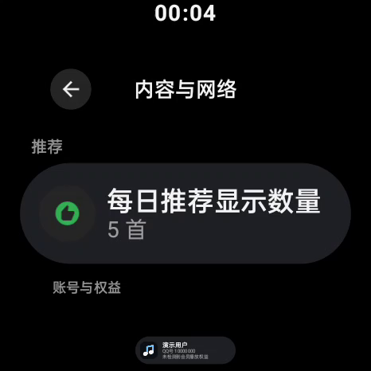 | 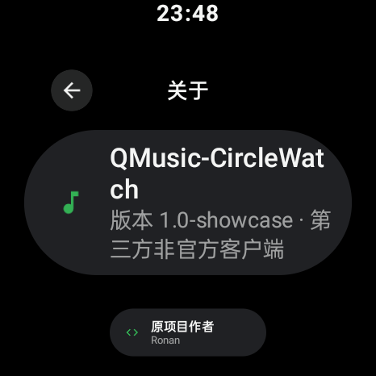 | 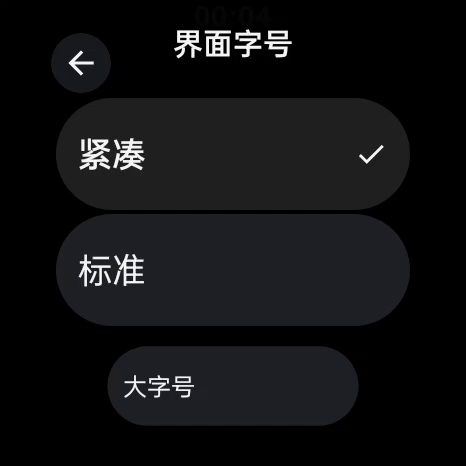 |

### 确认弹窗

| 确认弹窗 |
| :---: |
| 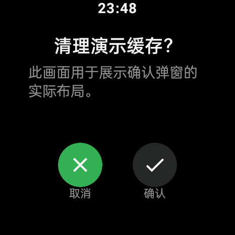 |

完整清单与复现方式见 [截图说明](docs/SCREENSHOTS.md)，也可打开本地 [界面浏览页](docs/preview/index.html)。静态图片不能体现动画帧率与振动强度。

## 第一次使用

1. 从本仓库 Release 下载 `QMusic-CircleWatch-1.0.apk` 并安装到手表。
2. 已安装本二创版本时可直接覆盖安装，包名与签名保持一致；原作者版本可与本应用并存，需在本应用授权。
3. 连接可正常上网的 Wi-Fi 或热点，在登录页按提示扫码；图库中的示例二维码不能使用。
4. 从发现、搜索或音乐库进入歌曲，点击底部播放胶囊打开播放器，切换到歌词页。
5. 列表可用触屏或表冠滚动。系统触觉关闭时不强制振动；播放页表冠音量可在设置关闭。

搜索或播放失败时，先检查网络、域名解析和登录状态。播放地址、音质和账号操作仍受上游平台限制。本版不安装原版自动更新 APK，后续更新以本仓库 Release 为准。

## 工程组成与实现

使用 **Kotlin + Jetpack Compose + Coroutines/Flow + Room/DataStore + Media3**；结合用户提供的 OPPO 控件和圆表资料适配设备能力。

界面层负责圆屏几何、胶囊控件、迷你播放器与歌词绘制；ViewModel 协调状态，网络和存储沿用原工程；表冠事件按可见区域分发，过滤和限速后触发节流短震。

- [工程结构与数据流](docs/ARCHITECTURE.md)
- [构建、签名和离线展示](docs/BUILDING.md)
- [详细功能说明](docs/FEATURES.md)
- [二创与原版对照](docs/UPSTREAM_DIFF.md)

```powershell
.\gradlew.bat :app:assembleDebug
.\gradlew.bat :app:testDebugUnitTest :app:lintDebug
```

需要 JDK 21、Android SDK 36。正式包还需维护者本地签名；仓库不包含私钥、口令、个人账号与原始设备日志。

## 验证与服务边界

实机已验证搜索、在线播放、暂停、歌词、迷你播放器切换、时间区与列表。用户已确认实体表冠正常滚动、有短震，快速或反向操作不再抽动。演示数据不能代替线上业务验收。

重新扫码完整授权、收藏与歌单写入、真实离线缓存、蓝牙及全部会员音质组合尚未逐项完成实机验收，不能据此声称全部线上功能已经验证。既有业务与权限判断保留。

## 来源与许可证

- 原工程：[huanghao897/QMusicWatch](https://github.com/huanghao897/QMusicWatch)，导入基线 0.9.14。
- 圆表参考：[OPPO 官方适配文档](https://open.oppomobile.com/documentation/page/info?id=12357)，及用户提供的设计资料和控件。
- 保留 [Apache-2.0](LICENSE)、[NOTICE 与署名](NOTICE.md)、[第三方说明](THIRD_PARTY.md) 和 [原版 README](README.upstream.md)。
- OPPO 本地依赖用于复现本次适配；其权利与使用条件归原发行方，不随本工程重新许可。

本 README 的 1.0 为二次开发版本号，与原工程 0.9.x 的序列分别维护。
