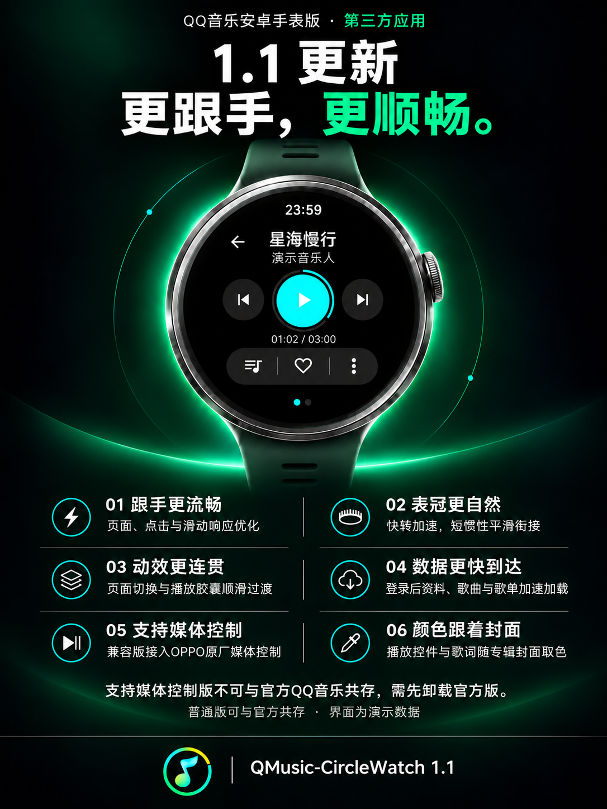

# QMusic-CircleWatch 1.1

更新日期：2026-11-07。当前仓库为私有审阅状态，1.1 安装包保留在发布草稿中；确认后再转为公开。

QQ 音乐安卓手表版第三方应用，面向圆形表盘；保留原工程来源、许可证和账号权益校验。本次提供同一份工程生成的两个正式签名 APK，应用功能与界面一致，区别在于包名和 OPPO 原厂媒体控制接入。

## 两个安装版本

| 项目 | 支持媒体控制版 | 普通版（可共存） |
| --- | --- | --- |
| 安装包 | QMusic-CircleWatch-1.1-支持媒体控制版.apk | QMusic-CircleWatch-1.1.apk |
| OPPO 原厂媒体控制 | OWW251 已验证歌曲、封面、图标及播放/暂停/上下首 | 当前 OWW251 固定名单不识别 |
| 与官方 QQ 音乐手表版共存 | 不支持 | 支持 |
| 应用包名 | com.tencent.qqmusicwatch | com.qmusicwatch.round |
| 应用身份 | QMusic-CircleWatch 第三方应用，本项目图标与签名 | QMusic-CircleWatch 第三方应用，本项目图标与签名 |
| 覆盖更新 | 使用同包名、同签名的兼容版 | 使用同包名、同签名的独立版 |

这里的“媒体控制”指手表内 OPPO 原厂媒体控制程序。独立版仍发布标准 Android 媒体会话；不将原厂固定名单限制等同于所有系统控制器或蓝牙控制都不可用。Watch X3 未连接实测，不能保证它与当前设备有相同表现。

两版账户和缓存各自独立，不能通过跨版本安装自动迁移。兼容版与官方 QQ 音乐包名相同、签名不同，不能直接覆盖官方版；卸载官方版会删除其本地数据，安装前请自行确认。两版都不会安装上游原客户端的更新 APK。

## 1.1 主要更新

- 重点优化整体 APP 的使用流畅度与跟手性，改善页面打开、点击反馈、列表滑动等日常操作的响应，减少不必要的等待和界面刷新。
- 优化表冠滚动表现，调整快慢旋转的速度反馈、短惯性与首次起转响应，让滚动阻尼和松手后的停顿过渡更自然流畅。
- 优化页面打开、切换与逐层返回的动效，以及胶囊播放悬浮窗的展开和收起效果，让专辑图与容器的过渡更加连贯自然。
- 优化网络请求与数据复用，缩短登录后用户资料、歌曲列表及歌单的加载等待，让内容更快显示，重复进入页面时更快响应。
- 新增“支持媒体控制版”，在当前已验证的 OPPO 手表原厂媒体控制中显示歌曲、歌手、封面与应用图标，并支持播放、暂停及上下首操作。
- 支持专辑封面取色，播放控件、进度环及歌词高亮随当前歌曲的封面自动变换配色，让播放界面保持统一。

> **安装提示：** 支持媒体控制版使用与手表官方 QQ 音乐相同的应用包名，占用相同的安装位置，因此无法与官方 QQ 音乐共存。用户必须先卸载手表上的官方 QQ 音乐，才能安装此版本；卸载会删除官方应用的本地登录与下载数据。普通版可以与官方 QQ 音乐共存。

### 其他优化与修复

- 命名列表保留顶部标题与返回入口，播放队列搜索栏随滚动收起；右滑按页面层级返回。
- 完善逐字歌词和双语翻译的自动加载与显示，长歌词完整换行，播放控件与歌词随专辑封面配色。
- 修复播放进度、播放/暂停图标及歌词跟随的状态同步；操作菜单采用带叉号和“取消”文字的圆形悬浮按钮。
- 完善完整歌单缓存、读取重试、账号隔离和旧请求结果处理，保留现有音乐功能与账号权益校验。

## 验证范围

默认版 268 项自动回归通过，Lint 0 错误、62 条警告；兼容包名下额外运行的 9 项媒体服务和状态传播检查通过。OWW251 已完成兼容版重新扫码、真实资料与歌单读取、播放及原厂媒体控制操作。

同一份 2582 首歌单的现场对照中，完整列表从旧包约 28.4–31.3 秒改善至约 18.5–22.8 秒，立即返回重进命中完整缓存。这是单次现场网络对照，不代表固定提速比例。

收藏/歌单写入、真实离线缓存、蓝牙与全部音质/会员组合未逐项重新验收。网络、曲库版权、账号状态和上游服务仍影响功能可用性。详情见 [验证说明](VERIFICATION.md)、[媒体兼容说明](MEDIA_COMPATIBILITY.md) 和 [网络优化说明](NETWORK_READ_20261107.md)。

## 工程与签名

源码压缩包包含本次工程、文档和许可证，不包含维护者私钥、口令、真实账号、原始设备资料、厂商分析 APK 或构建缓存。复现 Release 需要自行配置签名；自行签名不能覆盖维护者签名的安装包。

默认独立版：`gradlew.bat :app:assembleRelease`。

支持媒体控制版：`gradlew.bat :app:assembleRelease -PoppoMediaCompat=true`。

当前私有 main 与草稿内的源码 ZIP 同步为本次 1.1 工程。仓库继续保持私有，草稿不对外发布；用户确认后再开放仓库。历史 1.0 保留。
